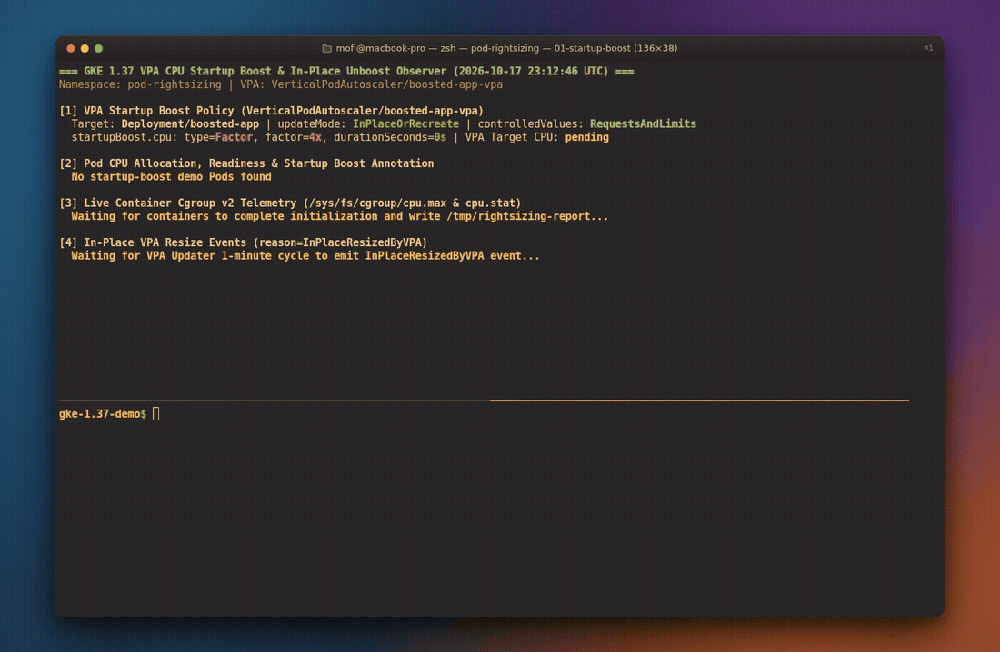
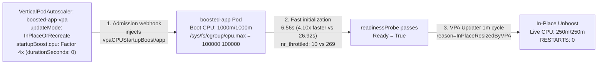

# Eliminating cold-start CPU throttling on GKE 1.37 with VPA CPU Startup Boost and In-Place Pod Resize

Sizing CPU for stateless services on Kubernetes usually forces an unpleasant trade-off between cold-start latency and steady-state waste.

Many production runtimes need a large burst of CPU during their first few seconds of life and only a fraction of that CPU once they are serving requests:

- **Java / JVM services** spend their first 10 to 30 seconds running classloading, Spring context initialization, and C2 JIT compilation.
- **Python and Node.js APIs** parse large dependency trees, initialize ORM metadata, and warm in-memory caches on boot.
- **AI/ML inference microservices** verify and deserialize model weights or compile execution graphs before `/readyz` can return `200 OK`.

If you size `requests.cpu` and `limits.cpu` for the steady-state baseline (for example, `250m`), the Linux kernel's Completely Fair Scheduler (CFS) throttles the container to 25 milliseconds of CPU time every 100 milliseconds (`/sys/fs/cgroup/cpu.max = 25000 100000`). A startup sequence that needs 6.5 CPU-seconds of execution stretches out to 27 seconds of wall-clock time while racking up hundreds of throttled periods (`nr_throttled` in `/sys/fs/cgroup/cpu.stat`). If you remove `limits.cpu` altogether, noisy neighbors on shared nodes make startup latency unpredictable. And if you size `requests.cpu` for the startup peak (`1000m`), 75% of your reserved CPU sits idle for the rest of the Pod's lifetime.

GKE 1.36+ (`1.36.0-gke.4447000+`) and GKE 1.37 solve this by combining two Vertical Pod Autoscaler (VPA) capabilities:

1. **VPA CPU Startup Boost** (`spec.startupBoost.cpu` on `VerticalPodAutoscaler` `autoscaling.k8s.io/v1`) instructs the GKE VPA admission webhook (`gke-vpa-webhook-config`) to multiply or add CPU requests and limits when a Pod is created (`type: "Factor"` or `type: "Quantity"`) and record the original baseline in a `vpaCPUStartupBoost/<container>` annotation.
2. **In-Place Unboost via In-Place Pod Vertical Scaling** (`spec.updatePolicy.updateMode: "InPlaceOrRecreate"`) watches for the Pod to pass its `readinessProbe` (`Ready=True`). Once `durationSeconds` elapses, the VPA Updater resizes the running container's CPU requests and limits back to baseline **in place** (`reason=InPlaceResizedByVPA`, `RESTARTS: 0`).

I built a zero-build reference repository at [github.com/gke-demos/pod-rightsizing](https://github.com/gke-demos/pod-rightsizing) (`manifests/01-startup-boost/`) to measure this on a live GKE `v1.37.0-gke.3503000` cluster. Two identical `alpine:3.20` Deployments (`throttled-app` and `boosted-app`) start side by side with a `250m` CPU baseline and execute the exact same deterministic CPU initialization workload while reporting their own live kernel cgroup v2 counters (`/sys/fs/cgroup/cpu.max` and `/sys/fs/cgroup/cpu.stat`).



*Watch the high-resolution MP4 recording: [assets/01-startup-boost-demo.mp4](https://github.com/gke-demos/pod-rightsizing/raw/main/assets/01-startup-boost-demo.mp4)*

## How VPA CPU Startup Boost and In-Place Unboost compare to static sizing

| Sizing approach | Startup CPU (`cpu.max`) | Cold-start time (`12M` iterations) | CFS throttled periods (`nr_throttled`) | Steady-state CPU request | Container restarts on downscale |
| :--- | :--- | :--- | :--- | :--- | :--- |
| **Static steady-state (`throttled-app`)** | `250m` (`25000 100000`) | `26,920ms` (`26.9s`) | `269` (`11,498ms` throttled) | `250m` | `0` |
| **Static over-provisioned (`1000m` forever)** | `1000m` (`100000 100000`) | `~6,560ms` (`6.6s`) | `~10` | `1000m` (75% wasted) | `0` |
| **VPA CPU Startup Boost + `InPlaceOrRecreate` (`boosted-app`)** | `1000m` during boot (`Factor: 4`) | **`6,560ms` (`4.10x faster`)** | **`10` (`42ms` throttled)** | **`250m` after `Ready`** | **`0` (`InPlaceResizedByVPA`)** |

## What happens under the hood



The lifecycle runs in three stages:

1. **Admission-time boost (`gke-vpa-webhook-config`).** When `Deployment/boosted-app` creates a Pod with `requests.cpu: 250m` and `limits.cpu: 250m`, the GKE VPA mutating admission webhook intercepts the `CREATE` request. It multiplies both the CPU request and CPU limit by `factor: 4` (`1` vCPU / `1000m`) and records the original baseline in `metadata.annotations["vpaCPUStartupBoost/app"] = '{"requests":{"cpu":"250m","memory":"128Mi"},"limits":{"cpu":"250m","memory":"128Mi"}}'`.
2. **Unthrottled initialization.** `kubelet` creates the container with `/sys/fs/cgroup/cpu.max` set to `100000 100000` (100ms quota per 100ms period). The container finishes its initialization loop in **6.56 seconds** (compared to **26.92 seconds** for `throttled-app`) and creates `/tmp/ready` so its `readinessProbe` flips the Pod to `Ready=True`.
3. **Zero-restart In-Place Unboost (`InPlaceResizedByVPA`).** The VPA Updater evaluates boosted Pods on a 1-minute cycle. Because `boosted-app` is now `Ready=True` and `durationSeconds` is `0`, VPA patches the Pod's CPU request and limit back to `250m` in place, clears the `vpaCPUStartupBoost/app` annotation, and emits an `InPlaceResizedByVPA` event. Inside the running container, `/sys/fs/cgroup/cpu.max` drops from `100000 100000` (`1000m`) to `25000 100000` (`250m`) with **`RESTARTS: 0`**.

## Follow along on your own cluster

Clone the repository and make sure Vertical Pod Autoscaling is enabled on your GKE 1.37+ cluster:

```bash
git clone https://github.com/gke-demos/pod-rightsizing.git
cd pod-rightsizing
```

### Step 1: Inspect the VPA Startup Boost policy

Look at `manifests/01-startup-boost/01-vpa-startup-boost.yaml`:

```yaml
apiVersion: autoscaling.k8s.io/v1
kind: VerticalPodAutoscaler
metadata:
  name: boosted-app-vpa
  namespace: pod-rightsizing
spec:
  targetRef:
    apiVersion: apps/v1
    kind: Deployment
    name: boosted-app
  updatePolicy:
    updateMode: "InPlaceOrRecreate"
  startupBoost:
    cpu:
      type: "Factor"
      factor: 4
      durationSeconds: 0
  resourcePolicy:
    containerPolicies:
      - containerName: app
        controlledValues: RequestsAndLimits
        minAllowed:
          cpu: 250m
          memory: 128Mi
        maxAllowed:
          cpu: 2000m
          memory: 256Mi
```

Two settings here prevent subtle production surprises:

- **`controlledValues: RequestsAndLimits` preserves QoS during in-place resize.** Kubernetes In-Place Pod Resize cannot change a Pod's `qosClass` (for example, between `Guaranteed` and `Burstable`). Scaling both `requests.cpu` and `limits.cpu` together keeps the Pod's QoS class invariant across both the 4x boost (`1000m/1000m`) and the **In-Place Unboost** (`250m/250m`), so VPA never falls back to recreating the Pod ([ADR-0002](docs/adr/0002-requests-and-limits-qos-preservation-for-in-place-unboost.md)).
- **`durationSeconds: 0` paired with a `readinessProbe`.** Releasing the boost as soon as the container passes its `readinessProbe` ensures that startup CPU spikes never spill into the `Ready` window where a Horizontal Pod Autoscaler would misinterpret them as traffic demand ([ADR-0001](docs/adr/0001-readiness-probe-and-zero-duration-for-hpa-safe-startup-boost.md)).

### Step 2: Deploy the side-by-side workloads

 Both `throttled-app` and `boosted-app` in `manifests/01-startup-boost/02-workloads.yaml` have the exact same container spec (`250m` CPU request and limit, `128Mi` memory, and a `readinessProbe` that checks `test -f /tmp/ready`). Before marking itself ready, each container runs `12,000,000` iterations of floating-point math and records the delta in `/sys/fs/cgroup/cpu.stat` (`nr_throttled` and `throttled_usec`) and `/sys/fs/cgroup/cpu.max`.

Apply the VPA policy and both Deployments with a single command:

```bash
make apply-startup-boost
```

### Step 3: Watch the cold start and In-Place Unboost

Run `make watch-startup-boost` (or `make status` for a single snapshot):

```bash
make watch-startup-boost
```

During the first 25 seconds after deployment, `boosted-app` runs with `1000m/1000m` CPU and `vpaCPUStartupBoost/app` active, finishing initialization in **6.56 seconds** while `throttled-app` is still throttled at `250m`:

```text
[2] Pod CPU Allocation, Readiness & Startup Boost Annotation
  POD                            ROLE      READY  RESTARTS SPEC-REQ/LIM   STATUS-ACT  BOOST-ANNOTATION (vpaCPUStartupBoost/app)
  throttled-app-7458896549-78rkx throttled False  0        250m/250m      250m        <unboosted control>
  boosted-app-6d96ddb959-trmc9   boosted   True   0        1000m/1000m    1000m       active (base=250m/250m)
```

Once `throttled-app` finishes at **26.92 seconds** and the VPA Updater runs its 1-minute evaluation cycle, `boosted-app` is resized in place back to `250m/250m` with **`RESTARTS: 0`**:

```text
=== GKE 1.37 VPA CPU Startup Boost & In-Place Unboost Observer (2026-10-17 23:02:50 UTC) ===
Namespace: pod-rightsizing | VPA: VerticalPodAutoscaler/boosted-app-vpa

[1] VPA Startup Boost Policy (VerticalPodAutoscaler/boosted-app-vpa)
  Target: Deployment/boosted-app | updateMode: InPlaceOrRecreate | controlledValues: RequestsAndLimits
  startupBoost.cpu: type=Factor, factor=4x, durationSeconds=0s | VPA Target CPU: pending

[2] Pod CPU Allocation, Readiness & Startup Boost Annotation
  POD                            ROLE      READY  RESTARTS SPEC-REQ/LIM   STATUS-ACT  BOOST-ANNOTATION (vpaCPUStartupBoost/app)
  throttled-app-7458896549-78rkx throttled True   0        250m/250m      250m        <unboosted control>
  boosted-app-6d96ddb959-trmc9   boosted   True   0        250m/250m      250m        <none / cleared>

[3] Live Container Cgroup v2 Telemetry (/sys/fs/cgroup/cpu.max & cpu.stat)
  POD                            ROLE      BOOT-CGROUP  LIVE-CGROUP  STARTUP-MS  NR-THROTTLED  THROTTLED-MS
  boosted-app-6d96ddb959-trmc9   boosted   1000m        250m         6560ms      10            42ms
  throttled-app-7458896549-78rkx throttled 250m         250m         26920ms     269           11498ms

  Cold-Start Result: boosted-app initialized in 6560ms vs. 26920ms (4.10x faster, CFS throttled periods: 269 -> 10)

[4] In-Place VPA Resize Events (reason=InPlaceResizedByVPA)
  ✓ [2026-10-17T23:02:25Z] boosted-app-6d96ddb959-trmc9: Pod was resized in place by VPA Updater.
```

Look at section `[3]` above: `boosted-app` recorded `BOOT-CGROUP: 1000m` when the container started, and after `InPlaceResizedByVPA` fired at `23:02:25Z`, the same process observed its own `LIVE-CGROUP` (`/sys/fs/cgroup/cpu.max`) drop to `250m` without restarting (`RESTARTS: 0`).

## Operational details worth knowing

1. **Apply the `VerticalPodAutoscaler` before creating Pods.** Because `gke-vpa-webhook-config` mutates Pods only during initial Pod creation, existing Pods created before the VPA exists will not receive a startup boost. Similarly, if a container crashes and `kubelet` restarts it in place (`RESTARTS: 1`) after the unboost has already completed, the admission webhook does not re-run ([ADR-0004](docs/adr/0004-admission-only-boost-semantics-on-container-restart.md)).
2. **Annotation casing on GKE 1.37 (`vpaCPUStartupBoost`).** On live GKE 1.37 clusters, the admission webhook writes the annotation key with uppercase `CPU`: `vpaCPUStartupBoost/<container-name>` (alongside `vpaObservedContainers` and `vpaUpdates`). When the VPA Updater finishes the **In-Place Unboost**, it removes `vpaCPUStartupBoost/<container-name>` from the Pod metadata.
3. **Using startup boost without continuous VPA resizing (`updateMode: "Off"`).** If you want VPA to manage only the temporary startup boost and the in-place unboost back to your static Pod spec baseline without applying ongoing VPA recommendations, you can set `spec.updatePolicy.updateMode: "Off"` alongside `spec.startupBoost`.

In [Part 2 (`BLOG-02-VPA-HPA-RIGHTSIZING.md`)](BLOG-02-VPA-HPA-RIGHTSIZING.md), we combine **VPA CPU Startup Boost** and **In-Place Pod Resize** with a CPU-based `HorizontalPodAutoscaler` (`gke.io/autoscaling-hpa-rightsizing-mode: "gke-hpa-rightsizing-mode-policy"`) so GKE rightsizes per-Pod CPU baselines in place while scaling replicas horizontally during traffic spikes.
