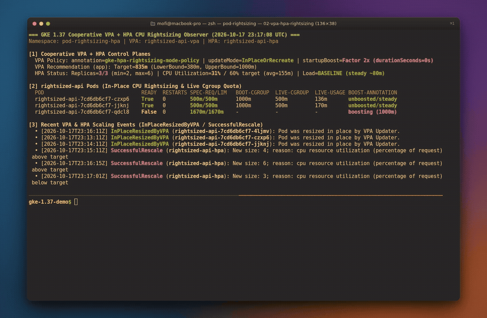
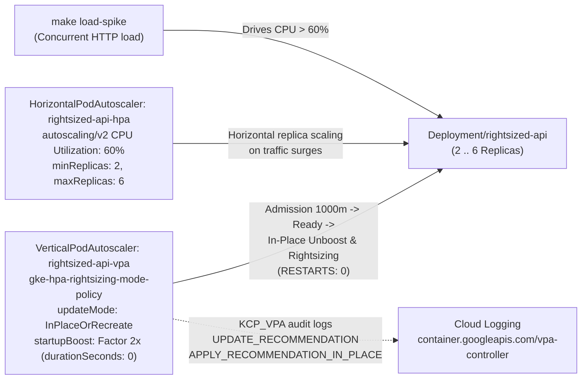

# Cooperative VPA and HPA CPU rightsizing on GKE 1.37 without Pod restarts

For years, one of the first rules of Kubernetes autoscaling was simple: **do not run Vertical Pod Autoscaler (VPA) and Horizontal Pod Autoscaler (HPA) together on CPU.**

The reason was math. A CPU-based HPA calculates replica count from utilization percentage:

$$\text{Utilization \%} = \frac{\text{Current Pod CPU Usage}}{\text{Pod Requested CPU}}$$

With standard VPA, both control loops pull on the same rope. When VPA lowers a Pod's CPU request to eliminate slack, the denominator shrinks, HPA sees a sudden jump in utilization percentage, and HPA scales out extra replicas even though traffic has not changed. Worse, traditional VPA (`Recreate` / `Auto`) had to evict and restart Pods to change their CPU requests, causing capacity dips and cold-start spikes right in the middle of serving traffic.

As a result, almost every team running stateless APIs chose HPA for horizontal scale-out and left per-Pod CPU requests as static guesses forever.

GKE 1.36.3+ (`1.36.3-gke.1630000+`) and GKE 1.37 remove that limitation by combining three capabilities on the same workload:

1. **Cooperative VPA + HPA CPU Rightsizing** (`metadata.annotations["gke.io/autoscaling-hpa-rightsizing-mode"] = "gke-hpa-rightsizing-mode-policy"`) makes VPA aware of your HPA configuration (`minReplicas`, `maxReplicas`, and target `averageUtilization`). HPA handles short-term traffic surges by adding or removing replicas, while VPA evaluates historical aggregate CPU demand across the replica set to rightsize per-Pod CPU requests.
2. **In-Place Pod Vertical Scaling (`updateMode: "InPlaceOrRecreate"`)** applies VPA's CPU recommendations directly to running containers (`reason=InPlaceResizedByVPA`, `RESTARTS: 0`) without evicting Pods.
3. **HPA-Safe VPA CPU Startup Boost (`startupBoost.cpu.durationSeconds: 0` + `readinessProbe`)** boosts CPU on newly scheduled or scaled-out replicas during initialization and unboosts them in place as soon as they become `Ready`, preventing cold-start CPU spikes from triggering false HPA scale-outs.

I built Demo 02 in [github.com/gke-demos/pod-rightsizing](https://github.com/gke-demos/pod-rightsizing) (`manifests/02-vpa-hpa-rightsizing/`) to show how these three control loops cooperate on a live GKE `v1.37.0-gke.3503000` cluster.



*Watch the high-resolution MP4 recording: [assets/02-vpa-hpa-rightsizing-demo.mp4](https://github.com/gke-demos/pod-rightsizing/raw/main/assets/02-vpa-hpa-rightsizing-demo.mp4)*

## How standard VPA + HPA compares to GKE 1.37 Cooperative Rightsizing

| Behavior | Standard VPA + CPU HPA (anti-pattern) | GKE 1.37 Cooperative VPA + HPA (`gke-hpa-rightsizing-mode-policy`) |
| :--- | :--- | :--- |
| **Control-loop coordination** | Competes over CPU utilization denominator; causes replica oscillation | VPA factors in HPA `minReplicas`, `maxReplicas`, and target utilization |
| **Applying CPU request changes** | Evicts and recreates Pods (`Recreate`), triggering fresh cold starts | Mutates cgroup CPU requests/limits in place (`InPlaceOrRecreate`, `RESTARTS: 0`) |
| **Cold starts during HPA scale-out** | New replicas either throttle at steady-state CPU or fool HPA into over-scaling | New replicas boost 2x at admission and unboost in place once `Ready` (`durationSeconds: 0`) |
| **Auditability** | Opaque controller logs | Structured JSON decision events in Cloud Logging (`KCP_VPA` / `vpa-controller`) |

## Architecture of Demo 02 (`02-vpa-hpa-rightsizing`)



Inside the `pod-rightsizing-hpa` namespace, we deploy three resources:

1. **`Deployment/rightsized-api` (`manifests/02-vpa-hpa-rightsizing/02-workload.yaml`)**: Starts with `replicas: 2` and an intentionally over-provisioned `500m` CPU request and `500m` CPU limit (`128Mi` memory). On startup, each replica runs a CPU-intensive initialization task before marking `/tmp/ready` for its `readinessProbe`. At baseline (`ConfigMap/rightsized-api-load: mode=baseline`), each Pod uses ~`80m`–`100m` of CPU (well below its `500m` initial request).
2. **`VerticalPodAutoscaler/rightsized-api-vpa` (`manifests/02-vpa-hpa-rightsizing/01-vpa-hpa.yaml`)**: Annotated with `gke.io/autoscaling-hpa-rightsizing-mode: "gke-hpa-rightsizing-mode-policy"`, `updateMode: "InPlaceOrRecreate"`, and `startupBoost.cpu: {type: "Factor", factor: 2, durationSeconds: 0}`.
3. **`HorizontalPodAutoscaler/rightsized-api-hpa` (`manifests/02-vpa-hpa-rightsizing/01-vpa-hpa.yaml`)**: Uses `autoscaling/v2` to scale `Deployment/rightsized-api` between `minReplicas: 2` and `maxReplicas: 6` targeting `averageUtilization: 60` on CPU.

## Follow along on your own cluster

### Step 1: Inspect the cooperative VPA and HPA manifest

Look at `manifests/02-vpa-hpa-rightsizing/01-vpa-hpa.yaml`:

```yaml
apiVersion: autoscaling.k8s.io/v1
kind: VerticalPodAutoscaler
metadata:
  name: rightsized-api-vpa
  namespace: pod-rightsizing-hpa
  annotations:
    gke.io/autoscaling-hpa-rightsizing-mode: "gke-hpa-rightsizing-mode-policy"
spec:
  targetRef:
    apiVersion: apps/v1
    kind: Deployment
    name: rightsized-api
  updatePolicy:
    updateMode: "InPlaceOrRecreate"
  startupBoost:
    cpu:
      type: "Factor"
      factor: 2
      durationSeconds: 0
  resourcePolicy:
    containerPolicies:
      - containerName: app
        controlledResources: ["cpu", "memory"]
        controlledValues: RequestsAndLimits
        minAllowed:
          cpu: 100m
          memory: 128Mi
        maxAllowed:
          cpu: 1000m
          memory: 256Mi
---
apiVersion: autoscaling/v2
kind: HorizontalPodAutoscaler
metadata:
  name: rightsized-api-hpa
  namespace: pod-rightsizing-hpa
spec:
  scaleTargetRef:
    apiVersion: apps/v1
    kind: Deployment
    name: rightsized-api
  minReplicas: 2
  maxReplicas: 6
  behavior:
    scaleDown:
      stabilizationWindowSeconds: 15
  metrics:
    - type: Resource
      resource:
        name: cpu
        target:
          type: Utilization
          averageUtilization: 60
```

Deploy the VPA, HPA, and `rightsized-api` workload:

```bash
make apply-vpa-hpa
```

### Step 2: Observe HPA-safe Startup Boost and In-Place Rightsizing

Open the live observer with `make watch-vpa-hpa` (or `make status-vpa-hpa` for a single snapshot):

```bash
make watch-vpa-hpa
```

When the two `rightsized-api` Pods are created, the VPA admission webhook boosts their CPU request and limit 2x from `500m` to `1000m` (`vpaCPUStartupBoost/app`). Because `rightsized-api` only passes its `readinessProbe` (`test -f /tmp/ready`) *after* its startup CPU loop finishes, and because `startupBoost.cpu.durationSeconds` is set to `0`, the VPA Updater unboosts both Pods in place (`reason=InPlaceResizedByVPA`, `RESTARTS: 0`) without triggering a false HPA scale-out.

Within two minutes of collecting baseline metrics, VPA also computes its cooperative CPU recommendation (`Target: 275m`) and resizes the running containers in place with zero restarts:

```text
=== GKE 1.37 Cooperative VPA + HPA CPU Rightsizing Observer (2026-10-17 23:11:18 UTC) ===
Namespace: pod-rightsizing-hpa | Target: Deployment/rightsized-api

[1] Cooperative VPA Rightsizing Policy (VerticalPodAutoscaler/rightsized-api-vpa)
  hpa-rightsizing-mode: gke-hpa-rightsizing-mode-policy | updateMode: InPlaceOrRecreate | controlledValues: RequestsAndLimits
  startupBoost.cpu: factor=2x (duration=0s) | VPA Recommendation -> Target: 275m (Lower: 100m, Upper: 1000m, Uncapped: 275m)

[2] Horizontal Pod Autoscaler (HorizontalPodAutoscaler/rightsized-api-hpa)
  Replicas: current=2 / desired=2 (min=2, max=6) | CPU Utilization: 23% / 60% target

[3] Pod CPU Allocation, Live Cgroup v2 Quota & Zero-Restart Status
  POD                             READY  RESTARTS SPEC-REQ/LIM   LIVE-CGROUP  STARTUP-MS  BOOST-ANNOTATION (vpaCPUStartupBoost/app)
  rightsized-api-7cd6db6cf7-b5w47 True   0        500m/500m      500m         2360ms      <none / cleared>
  rightsized-api-7cd6db6cf7-x4w8z True   0        500m/500m      500m         2400ms      <none / cleared>
```

### Step 3: Trigger a traffic surge (`make load-spike`)

Now trigger a CPU demand spike across `Deployment/rightsized-api`:

```bash
make load-spike
```

Switching `ConfigMap/rightsized-api-load` to `mode: spike` ramps per-Pod CPU demand past the 60% target, and `HorizontalPodAutoscaler/rightsized-api-hpa` scales `Deployment/rightsized-api` out horizontally (`2 -> 4 -> 6` replicas, `reason=SuccessfulRescale`). Every newly scaled-out replica receives the 2x **CPU Startup Boost** (`1000m`) at admission so it initializes quickly, and then unboosts in place (`InPlaceResizedByVPA`, `RESTARTS: 0`) on the next VPA Updater cycle:

```text
[2] Horizontal Pod Autoscaler (HorizontalPodAutoscaler/rightsized-api-hpa)
  Replicas: current=4 / desired=4 (min=2, max=6) | CPU Utilization: 100% / 60% target

[3] Pod CPU Allocation, Live Cgroup v2 Quota & Zero-Restart Status
  POD                             READY  RESTARTS SPEC-REQ/LIM   LIVE-CGROUP  STARTUP-MS  BOOST-ANNOTATION (vpaCPUStartupBoost/app)
  rightsized-api-7cd6db6cf7-4ljmv True   0        1000m/1000m    1000m        2700ms      active (base=500m/500m)
  rightsized-api-7cd6db6cf7-b5w47 True   0        500m/500m      500m         2360ms      <none / cleared>
  rightsized-api-7cd6db6cf7-tltwm True   0        1000m/1000m    1000m        2620ms      active (base=500m/500m)
  rightsized-api-7cd6db6cf7-x4w8z True   0        500m/500m      500m         2400ms      <none / cleared>

[4] Recent Cooperative VPA & HPA Scaling Events
  ✓ [2026-10-17T23:10:02Z] VPA InPlaceResizedByVPA (rightsized-api-7cd6db6cf7-b5w47): Pod was resized in place by VPA Updater.
  ✓ [2026-10-17T23:10:02Z] VPA InPlaceResizedByVPA (rightsized-api-7cd6db6cf7-x4w8z): Pod was resized in place by VPA Updater.
  ⇄ [2026-10-17T23:12:03Z] HPA SuccessfulRescale (rightsized-api-hpa): New size: 4; reason: cpu resource utilization (percentage of request) above target
```

When you stop the traffic spike:

```bash
make stop-load-spike
```

HPA scales the replica count back down to `minReplicas: 2` once `stabilizationWindowSeconds` elapses.

## Auditing VPA decisions in Cloud Logging (`KCP_VPA`)

When you enable `KCP_VPA` control-plane logging on a GKE 1.36+ or 1.37 cluster (`--logging=SYSTEM,WORKLOAD,KCP_VPA`), GKE exports structured JSON decision events from `vpa_event_logger.go` to `logName="projects/<PROJECT_ID>/logs/container.googleapis.com%2Fvpa-controller"`:

- **`UPDATE_RECOMMENDATION`**: Emitted once per minute for each VPA object with `recommendationMode` (`"HPA_RIGHTSIZING"` when cooperative VPA + HPA rightsizing is active, or `"DEFAULT"` for standard VPA), `recommendedResources` (`target`, `lowerBound`, `upperBound`, `uncappedTarget`), and `confidence` (`LOW` or `HIGH`).
- **`APPLY_RECOMMENDATION_IN_PLACE` / `APPLY_RECOMMENDATION_ON_EVICTION`**: Emitted when VPA mutates a Pod's resources in place or at admission/eviction, recording the exact `appliedResources` (`requests` and `limits`) and `pod` name.
- **`EVICT_POD`**: Emitted only when VPA runs in `Recreate` mode or when an in-place resize cannot be satisfied on the current node and falls back to eviction.

You can query these events directly in Logs Explorer:

```text
logName:"logs/container.googleapis.com%2Fvpa-controller"
jsonPayload.vpaNamespace="pod-rightsizing-hpa"
jsonPayload.vpaName="rightsized-api-vpa"
```

Here is a real `UPDATE_RECOMMENDATION` payload emitted by `vpa-controller` for `rightsized-api-vpa` showing `"recommendationMode": "HPA_RIGHTSIZING"`:

```json
{
  "operation": "UPDATE_RECOMMENDATION",
  "recommendationMode": "HPA_RIGHTSIZING",
  "confidence": "LOW",
  "vpaNamespace": "pod-rightsizing-hpa",
  "vpaName": "rightsized-api-vpa",
  "target": {
    "apiVersion": "apps/v1",
    "kind": "Deployment",
    "name": "rightsized-api"
  },
  "recommendedResources": [
    {
      "containerName": "app",
      "lowerBound": {
        "cpu": "100m",
        "memory": "128Mi"
      },
      "target": {
        "cpu": "275m",
        "memory": "128Mi"
      },
      "uncappedTarget": {
        "cpu": "275m",
        "memory": "1Mi"
      },
      "upperBound": {
        "cpu": "1",
        "memory": "256Mi"
      }
    }
  ],
  "state": "SUCCEEDED"
}
```

## Production guardrails to keep in mind

1. **Phased rollout for existing production workloads.** While Demo 02 starts directly in `updateMode: "InPlaceOrRecreate"`, for existing production services you can deploy the `VerticalPodAutoscaler` with `gke.io/autoscaling-hpa-rightsizing-mode: "gke-hpa-rightsizing-mode-policy"` and `updateMode: "Off"` first so VPA gathers traffic cycles before you switch `updateMode` to `"InPlaceOrRecreate"`.
2. **Multi-container Pods with sidecars.** If your Pod runs application sidecars alongside the primary container, configure your `autoscaling/v2` HPA to use `type: ContainerResource` targeting the primary container's CPU rather than Pod-wide `type: Resource` so HPA and VPA evaluate the same container baseline.
3. **Avoid the partial teardown footgun.** When disabling cooperative HPA rightsizing on a workload, always set `spec.updatePolicy.updateMode: "Off"` or delete the `VerticalPodAutoscaler` resource. Never remove *only* the `gke.io/autoscaling-hpa-rightsizing-mode` annotation while leaving `updateMode: "InPlaceOrRecreate"` active, or VPA will revert to standard non-cooperative mode and compete with HPA ([ADR-0003](docs/adr/0003-cooperative-vpa-hpa-rightsizing-policy-and-teardown-safety.md)).
4. **GitOps / Argo CD `ignoreDifferences`.** Because VPA mutates `spec.containers[].resources` in place on running Pods, configure your GitOps tool (such as Argo CD's `ignoreDifferences`) to ignore live container resource mutations if it syncs Pod specs directly.
