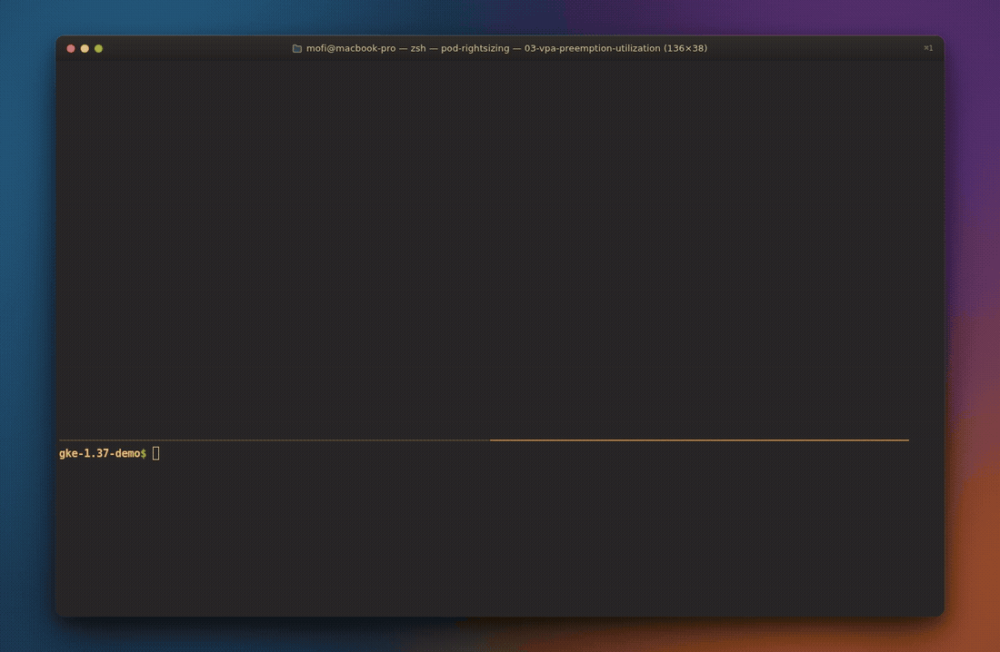
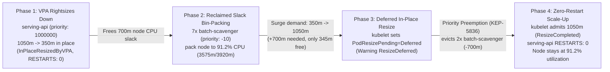

# High node utilization on GKE 1.37 with VPA In-Place Pod Resize and PriorityClass preemption

When Vertical Pod Autoscaler (VPA) rightsizes an over-provisioned serving Pod downward in place (`updateMode: "InPlaceOrRecreate"`), the node reclaims hundreds of millicores of allocatable CPU. That freed capacity only reduces your compute bill if the scheduler can place other work into it, such as background batch jobs, data pipelines, or opportunistic scavenger workloads (`PriorityClass: low-priority-batch`).

Bin-packing a node above 90% CPU utilization introduces a classic vertical scaling problem. What happens two hours later when traffic surges on your latency-sensitive serving Pod (`PriorityClass: high-priority-serving`) and it needs its CPU back in place?

Because low-priority batch Pods now occupy the node's remaining allocatable CPU, `kubelet` cannot admit the vertical scale-up. The container keeps running at its lower CPU allocation while `kubelet` marks the Pod with `PodResizePending: Deferred` (`reason=ResizeDeferred`, `Node didn't have enough resource: cpu`). Under GKE VPA's `InPlaceOrRecreate` mode, if an in-place resize remains `Deferred` for more than 5 minutes, the VPA Updater falls back to evicting and recreating the high-priority serving Pod (`reason=EvictedByVPA`). Instead of a zero-restart vertical scale-up, your critical serving Pod takes a cold restart.

Kubernetes 1.37 addresses this deadlock with **Scheduler Preemption for In-Place Pod Resize** ([KEP-5836](https://kubernetes.io/blog/2026/09/10/kubernetes-v1-37-scheduler-preemption-for-in-place-pod-resize-alpha/), feature gate `InPlacePodVerticalScalingSchedulerPreemption`). When a high-priority Pod's in-place scale-up is deferred by `kubelet` for lack of node capacity, the scheduler calculates the resource delta ($\Delta = \text{Desired} - \text{Allocated}$) and preempts lower-priority Pods on that same node. Once the low-priority Pods terminate and release their cgroup reservations, `kubelet` admits the high-priority Pod's in-place scale-up (`ResizeCompleted`) with **`RESTARTS: 0`**.

I built Demo 03 in [github.com/gke-demos/pod-rightsizing](https://github.com/gke-demos/pod-rightsizing) (`manifests/03-vpa-preemption-utilization/`) to demonstrate this complete node utilization lifecycle on a live GKE `v1.37.0-gke.3503000` cluster.



*Watch the high-resolution MP4 recording: [assets/03-vpa-preemption-utilization-demo.mp4](https://github.com/gke-demos/pod-rightsizing/raw/main/assets/03-vpa-preemption-utilization-demo.mp4)*

## How static headroom compares to VPA In-Place Resize with Priority Preemption

| Dimension | Static over-provisioned serving Pods | VPA In-Place Resize without Priority Preemption | VPA In-Place Resize + Priority Preemption (GKE 1.37) |
| :--- | :--- | :--- | :--- |
| **Steady-state node CPU utilization** | Low (40% to 60%), because idle CPU stays locked in peak requests | High (>90%) once low-priority batch Pods pack reclaimed slack | High (**91.2%** on `3920m` node) with low-priority batch Pods packing reclaimed slack |
| **Behavior when serving Pod scales up in place on a full node** | N/A (already paying for peak CPU 24/7) | Stuck in `PodResizePending: Deferred`; VPA falls back to `EvictedByVPA` after 5 minutes | `PodResizePending: Deferred` triggers eviction of `low-priority-batch` Pods on the same node |
| **Serving Pod restarts during vertical scale-up** | `0` | `1` (evicted and rescheduled after 5m timeout) | **`0` (`ResizeCompleted` in place)** |
| **Batch packer behavior (`preemptionPolicy: Never`)** | Cannot schedule into reserved serving slack | Blocks serving Pod scale-up | Yields CPU immediately to serving Pod and waits in `Pending` until slack returns |

## Architecture of Demo 03 (`03-vpa-preemption-utilization`)



Inside the `pod-rightsizing-preemption` namespace, Demo 03 deploys four components:

1. **Two `PriorityClass` tiers (`manifests/03-vpa-preemption-utilization/01-priority-vpa.yaml`)**:
   - `high-priority-serving` (`value: 1000000`, default `preemptionPolicy: PreemptLowerPriority`) for latency-sensitive serving traffic.
   - `low-priority-batch` (`value: -10`, `preemptionPolicy: Never`) for opportunistic batch scavenger Pods. Using a negative priority value (`-10`) with `preemptionPolicy: Never` guarantees that batch scavengers only consume genuinely idle node slack and never preempt normal default-priority (`0`) workloads.
2. **`VerticalPodAutoscaler/serving-api-vpa` (`01-priority-vpa.yaml`)**: Configures `updateMode: "InPlaceOrRecreate"`, `controlledValues: RequestsAndLimits`, and `startupBoost.cpu` (`factor: 3`, `durationSeconds: 0`).
3. **`Deployment/serving-api` (`02-serving-workload.yaml`)**: Runs with `priorityClassName: high-priority-serving`. It starts at `1050m` (`3x` boost above its `350m` request) during initialization and is rightsized down in place by VPA (`reason=InPlaceResizedByVPA`) to `350m` as soon as it becomes `Ready`, freeing `700m` of allocatable CPU on its node with `RESTARTS: 0`.
4. **`Deployment/batch-scavenger` (`03-batch-packers.yaml`)**: Runs with `priorityClassName: low-priority-batch`, `terminationGracePeriodSeconds: 2`, and `podAffinity` co-locating it on the same node (`kubernetes.io/hostname`) as `serving-api`. Each scavenger Pod requests `350m` CPU.

## How KEP-5836 calculates preemption for deferred in-place resizes

When `kube-scheduler` evaluates a Pod with `PodResizePending=True (reason=Deferred)`, it does not need to find a brand-new node for the entire Pod. The Pod is already running on its node and already holds its current `status.containerStatuses[].resources.requests` allocation.

Instead, the scheduler evaluates the **resource delta** required on the current node:

$$\Delta_{\text{CPU}} = \text{Desired}_{\text{CPU}} - \text{Allocated}_{\text{CPU}}$$

In Demo 03:
- `serving-api` is currently allocated `350m` (`status.containerStatuses[0].resources.requests.cpu = 350m`).
- During the demand surge, `serving-api` requests `1050m` (`spec.containers[0].resources.requests.cpu = 1050m`), so $\Delta_{\text{CPU}} = 1050\text{m} - 350\text{m} = 700\text{m}$.
- The node (`3920m` allocatable) is at **91.2% utilization (`3575m` allocated)**, leaving only **`345m` free CPU**.
- The additional node CPU deficit is $700\text{m} - 345\text{m} = 355\text{m}$.
- Evicting **2 `batch-scavenger` Pods** (`PriorityClass: low-priority-batch`, `priority: -10`, `2 * 350m = 700m`) on that same node frees `700m`, allowing `kubelet` to admit the `1050m` in-place resize immediately.

Meanwhile, because `kube-scheduler` in GKE 1.37 tracks pending in-place resizes using `max(Desired, Allocated)` (`max(1050m, 350m) = 1050m`), when the `batch-scavenger` ReplicaSet creates 2 replacement Pods, the scheduler sees that the node no longer has room for them and leaves those 2 replacement scavenger Pods in `Pending (Insufficient cpu)` while 5 scavenger Pods continue running alongside the `1050m` `serving-api` Pod.

### Running on Standard GKE 1.37 vs. GKE 1.37 Alpha clusters

In Kubernetes 1.37, `InPlacePodVerticalScaling` is GA (`true` by default on all GKE 1.37 clusters), while `InPlacePodVerticalScalingSchedulerPreemption` (KEP-5836) is an Alpha feature gate (`true` on GKE 1.37 Alpha clusters created with `--enable-kubernetes-alpha`, `false` on Standard GKE 1.37 clusters).

To make Demo 03 runnable on any GKE 1.37 cluster, `hack/preemption-ctl.sh` checks whether `PodResizePending: Deferred` was already resolved natively by `kube-scheduler` and, on Standard clusters where the Alpha feature gate is disabled, executes the exact KEP-5836 $\Delta_{\text{CPU}}$ victim selection and preemption on the target node.

## Follow along on your own cluster

### Step 1: Deploy the PriorityClasses, VPA policy, and high-priority serving workload

Look at `manifests/03-vpa-preemption-utilization/01-priority-vpa.yaml`:

```yaml
apiVersion: scheduling.k8s.io/v1
kind: PriorityClass
metadata:
  name: high-priority-serving
  labels:
    demo: vpa-preemption-utilization
value: 1000000
globalDefault: false
description: "Mission-critical serving tier that can preempt low-priority batch pods during in-place vertical scale-up."
---
apiVersion: scheduling.k8s.io/v1
kind: PriorityClass
metadata:
  name: low-priority-batch
  labels:
    demo: vpa-preemption-utilization
value: -10
preemptionPolicy: Never
globalDefault: false
description: "Opportunistic scavenger batch tier that packs reclaimed node CPU slack without preempting other pods and yields to high-priority serving resizes."
---
apiVersion: autoscaling.k8s.io/v1
kind: VerticalPodAutoscaler
metadata:
  name: serving-api-vpa
  namespace: pod-rightsizing-preemption
  labels:
    demo: vpa-preemption-utilization
spec:
  targetRef:
    apiVersion: apps/v1
    kind: Deployment
    name: serving-api
  updatePolicy:
    updateMode: "InPlaceOrRecreate"
  startupBoost:
    cpu:
      type: "Factor"
      factor: 3
      durationSeconds: 0
  resourcePolicy:
    containerPolicies:
      - containerName: app
        controlledResources: ["cpu", "memory"]
        controlledValues: RequestsAndLimits
        minAllowed:
          cpu: 250m
          memory: 128Mi
        maxAllowed:
          cpu: 1200m
          memory: 256Mi
```

Apply the PriorityClasses, VPA, and `serving-api` workload:

```bash
make apply-vpa-preemption
```

When `serving-api` starts, the GKE VPA admission webhook boosts its CPU request and limit to `1050m`. Once `serving-api` passes its `readinessProbe`, the VPA Updater rightsizes it down in place (`reason=InPlaceResizedByVPA`, `1050m -> 350m`, `RESTARTS: 0`), freeing `700m` of allocatable CPU on its node.

### Step 2: Bin-pack the reclaimed node slack above 90% CPU utilization

Now pack the node's reclaimed CPU slack with `low-priority-batch` scavenger Pods:

```bash
make pack-node-batch
```

Check the observer snapshot with `make status-vpa-preemption` (or `make watch-vpa-preemption` for live updates):

```text
=== GKE 1.37 VPA In-Place Resize + Priority Preemption Observer (2026-10-21 15:54:10 UTC) ===
Namespace: pod-rightsizing-preemption | Target Node: gke-worker-node-1 (allocatable=3920m)

[1] Target Node CPU Utilization & VPA / PriorityClass Policy
  Node CPU Allocated: [######################--] 91.2% (3575m / 3920m allocatable | 345m free)
  Breakdown: system=775m | high-priority-serving=350m (desired=350m) | low-priority-batch=2450m (7 scavenger pods)
  VPA Policy: updateMode=InPlaceOrRecreate | bounds=[250m..1200m] | VPA Target=1160m | Load=BASELINE (steady ~350m)

[2] Workload & Batch Scavenger Pods (In-Place Resize & Priority Preemption)
  POD                                PRIORITY-CLASS (VAL)         PHASE     RESTARTS DESIRED   ALLOCATED  LIVE-CGROUP  RESIZE / SCHEDULER STATE
  serving-api-8b47494c9-hltvz        high-priority-serving (1000000) Running   0        350m      350m       350m         InPlaceResizedByVPA (350m steady)
  batch-scavenger-6ff96f9785-6rth8   low-priority-batch (-10)     Running   0        350m      350m       350m         Packing Reclaimed Slack (350m)
  batch-scavenger-6ff96f9785-866p8   low-priority-batch (-10)     Running   0        350m      350m       350m         Packing Reclaimed Slack (350m)
  batch-scavenger-6ff96f9785-dhmdv   low-priority-batch (-10)     Running   0        350m      350m       350m         Packing Reclaimed Slack (350m)
  batch-scavenger-6ff96f9785-g5bmq   low-priority-batch (-10)     Running   0        350m      350m       350m         Packing Reclaimed Slack (350m)
  batch-scavenger-6ff96f9785-hjktk   low-priority-batch (-10)     Running   0        350m      350m       350m         Packing Reclaimed Slack (350m)
  batch-scavenger-6ff96f9785-k8p5h   low-priority-batch (-10)     Running   0        350m      350m       350m         Packing Reclaimed Slack (350m)
  batch-scavenger-6ff96f9785-vqzbr   low-priority-batch (-10)     Running   0        350m      350m       350m         Packing Reclaimed Slack (350m)
```

Seven `batch-scavenger` Pods (`350m` each, `2450m` total) are now running in the node's idle capacity, bringing `gke-worker-node-1` to **91.2% CPU request utilization (`3575m / 3920m`)** with only **`345m` free**.

### Step 3: Trigger an in-place scale-up on the packed node (`make trigger-resize-preemption`)

Now simulate a surge on `serving-api` that demands `1050m` CPU (`+700m` above its current `350m` allocation):

```bash
make trigger-resize-preemption
```

Because `700m` exceeds the `345m` free CPU on the node, `kubelet` immediately marks `serving-api` with `PodResizePending=True (reason=Deferred)` and emits a `ResizeDeferred` event:

```text
ResizeDeferred (serving-api-8b47494c9-hltvz): Pod resize OutOfcpu: {"containers":[{"name":"app","resources":{"limits":{"cpu":"1050m","memory":"128Mi"},"requests":{"cpu":"1050m","memory":"128Mi"}}}],"generation":3,"error":"Node didn't have enough resource: cpu, requested: 1050, used: 3225, capacity: 3920"}
```

Priority preemption then evicts two `low-priority-batch` Pods (`batch-scavenger-6ff96f9785-6rth8` and `batch-scavenger-6ff96f9785-866p8`, freeing `700m` CPU). Within two seconds, `kubelet` admits the `1050m` in-place resize on `serving-api`, updates `/sys/fs/cgroup/cpu.max` to `1050m`, and emits `ResizeCompleted` with **`RESTARTS: 0`**:

```text
=== GKE 1.37 VPA In-Place Resize + Priority Preemption Observer (2026-10-21 15:56:46 UTC) ===
Namespace: pod-rightsizing-preemption | Target Node: gke-worker-node-1 (allocatable=3920m)

[1] Target Node CPU Utilization & VPA / PriorityClass Policy
  Node CPU Allocated: [######################--] 91.2% (3575m / 3920m allocatable | 345m free)
  Breakdown: system=775m | high-priority-serving=1050m (desired=1050m) | low-priority-batch=1750m (5 scavenger pods)
  VPA Policy: updateMode=InPlaceOrRecreate | bounds=[1050m..1200m] | VPA Target=1160m | Load=SURGE (1050m scale-up demand)

[2] Workload & Batch Scavenger Pods (In-Place Resize & Priority Preemption)
  POD                                PRIORITY-CLASS (VAL)         PHASE     RESTARTS DESIRED   ALLOCATED  LIVE-CGROUP  RESIZE / SCHEDULER STATE
  serving-api-8b47494c9-hltvz        high-priority-serving (1000000) Running   0        1050m     1050m      1050m        ResizeCompleted (1050m, 0 restarts)
  batch-scavenger-6ff96f9785-5vhsz   low-priority-batch (-10)     Pending   0        350m      -          -            Pending (Unschedulable: Insufficient cpu)
  batch-scavenger-6ff96f9785-dhmdv   low-priority-batch (-10)     Running   0        350m      350m       350m         Packing Reclaimed Slack (350m)
  batch-scavenger-6ff96f9785-g5bmq   low-priority-batch (-10)     Running   0        350m      350m       350m         Packing Reclaimed Slack (350m)
  batch-scavenger-6ff96f9785-hjktk   low-priority-batch (-10)     Running   0        350m      350m       350m         Packing Reclaimed Slack (350m)
  batch-scavenger-6ff96f9785-k8p5h   low-priority-batch (-10)     Running   0        350m      350m       350m         Packing Reclaimed Slack (350m)
  batch-scavenger-6ff96f9785-vqzbr   low-priority-batch (-10)     Running   0        350m      350m       350m         Packing Reclaimed Slack (350m)
  batch-scavenger-6ff96f9785-w5vtm   low-priority-batch (-10)     Pending   0        350m      -          -            Pending (Unschedulable: Insufficient cpu)

[3] Recent Resize & Priority Preemption Events
  * [2026-10-21T15:56:11Z] ResizeCompleted (serving-api-8b47494c9-hltvz): Pod resize completed: {"containers":[{"name":"app","resources":{"limits":{"cpu":"350m","memory":"128Mi"},"requests":{"cpu":"350m","memory":"128Mi"}}}],"generation":2}
  * [2026-10-21T15:56:11Z] InPlaceResizedByVPA (serving-api-8b47494c9-hltvz): Pod resize in place by VPA Updater.
  * [2026-10-21T15:56:27Z] ResizeDeferred (serving-api-8b47494c9-hltvz): Pod resize OutOfcpu: {"containers":[{"name":"app","resources":{"limits":{"cpu":"1050m","memory":"128Mi"},"requests":{"cpu":"1050m","memory":"128Mi"}}}],"generation":3,"error":"Node didn't have enough resource: cpu, requested: 1050, used: 3225, capacity: 3920"}
  * [2026-10-21T15:56:33Z] PreemptedForInPlaceResize (serving-api-8b47494c9-hltvz): Preempted lower-priority batch pods (batch-scavenger-6ff96f9785-6rth8 batch-scavenger-6ff96f9785-866p8) on same node to free 700m CPU for in-place resize (350m -> 1050m)
  * [2026-10-21T15:56:38Z] FailedScheduling (batch-scavenger-6ff96f9785-5vhsz): 0/2 nodes are available: 1 Insufficient cpu, 1 node(s) didn't match pod affinity rules. preemption: not eligible due to preemptionPolicy=Never.
  * [2026-10-21T15:56:38Z] FailedScheduling (batch-scavenger-6ff96f9785-w5vtm): 0/2 nodes are available: 1 Insufficient cpu, 1 node(s) didn't match pod affinity rules. preemption: not eligible due to preemptionPolicy=Never.
  * [2026-10-21T15:56:38Z] ResizeCompleted (serving-api-8b47494c9-hltvz): Pod resize completed: {"containers":[{"name":"app","resources":{"limits":{"cpu":"1050m","memory":"128Mi"},"requests":{"cpu":"1050m","memory":"128Mi"}}}],"generation":3}
```

Notice what happened to the node utilization numbers:
- Before the surge: `serving-api` (`350m`) + 7 `batch-scavenger` Pods (`2450m`) + system Pods (`775m`) = **`3575m / 3920m` (91.2%)**.
- After the surge: `serving-api` (`1050m`, `RESTARTS: 0`) + 5 `batch-scavenger` Pods (`1750m`) + system Pods (`775m`) = **`3575m / 3920m` (91.2%)**, while the 2 preempted `batch-scavenger` replacement Pods wait cleanly in `Pending`.

When you are done exploring, tear down the Demo 03 resources:

```bash
make clean-vpa-preemption
```

## Production guardrails for high-utilization node bin-packing

1. **Set `value < 0` and `preemptionPolicy: Never` on scavenger `PriorityClass` objects.** Default priority in Kubernetes is `0`. Giving opportunistic batch packers a negative priority (`-10`) and `preemptionPolicy: Never` ensures they never evict default-priority workloads when scheduled or rescheduled ([ADR-0005](docs/adr/0005-priority-preemption-for-deferred-in-place-pod-resize.md)).
2. **Keep `terminationGracePeriodSeconds` short on preemptible batch Pods.** `kubelet` cannot admit the high-priority Pod's deferred in-place resize until the preempted lower-priority Pods finish terminating and release their cgroup allocations. Setting a fast graceful shutdown (or checkpoint-on-SIGTERM handler) on scavenger Pods minimizes the time `serving-api` spends in `PodResizePending: Deferred`.
3. **Understand VPA's 5-minute `EvictedByVPA` fallback timer.** Under `updateMode: "InPlaceOrRecreate"`, GKE VPA waits up to 5 minutes for a `PodResizePending: Deferred` condition (and 1 minute for `Infeasible`) before falling back to Pod eviction (`reason=EvictedByVPA`) so the Pod can be rescheduled onto a larger or less crowded node. Preempting lower-priority batch Pods within seconds resolves the `Deferred` condition long before the 5-minute fallback timer fires.
4. **Prevent Cluster Autoscaler scale-up churn on preempted scavengers.** If your cluster uses Cluster Autoscaler or Node Auto-Provisioning (NAP), mark opportunistic scavenger Pods with a priority below the Cluster Autoscaler expendable priority cutoff (`--expendable-pods-priority-cutoff`, default `-10`) so pending scavenger Pods waiting for reclaimed slack do not trigger new node provisioning.
