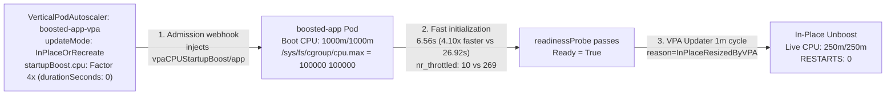
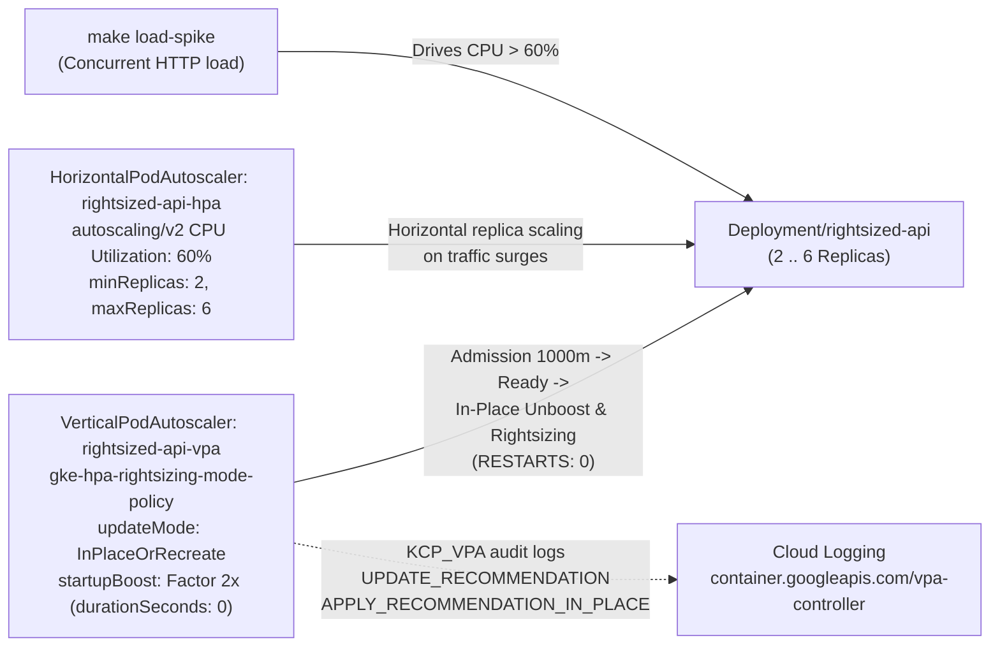
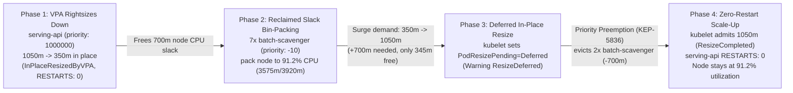

# Zero-restart Pod rightsizing on GKE 1.37

Zero-build reference repository for **Zero-Restart Pod Rightsizing** on GKE 1.37+ using **CPU Startup Boost** (`spec.startupBoost.cpu`), **In-Place Pod Resize** (`spec.updatePolicy.updateMode: "InPlaceOrRecreate"`), **Cooperative VPA + HPA Rightsizing** (`gke.io/autoscaling-hpa-rightsizing-mode: "gke-hpa-rightsizing-mode-policy"`), and **VPA Decision Audit Logs** (`KCP_VPA`).

This repository contains three self-contained, end-to-end live cluster demos:

| Demo | Focus | Namespace & Workloads | Manifests | Full Walkthrough |
| :--- | :--- | :--- | :--- | :--- |
| **Demo 01 (`01-startup-boost`)** | Eliminate cold-start Linux CFS throttling (`nr_throttled`) with a 4x temporary **CPU Startup Boost** (`250m -> 1000m`) and shrink back to baseline via **In-Place Unboost** (`reason=InPlaceResizedByVPA`, `RESTARTS: 0`) | `pod-rightsizing` / `Deployment/throttled-app` vs. `Deployment/boosted-app` | `manifests/01-startup-boost/` | [BLOG-01-STARTUP-BOOST.md](BLOG-01-STARTUP-BOOST.md) |
| **Demo 02 (`02-vpa-hpa-rightsizing`)** | Pair `VerticalPodAutoscaler` (`gke-hpa-rightsizing-mode-policy`, `InPlaceOrRecreate`, `startupBoost.cpu.durationSeconds: 0`) with an `autoscaling/v2` CPU `HorizontalPodAutoscaler` so VPA rightsizes per-Pod CPU in place while HPA scales replicas on traffic spikes | `pod-rightsizing-hpa` / `Deployment/rightsized-api` | `manifests/02-vpa-hpa-rightsizing/` | [BLOG-02-VPA-HPA-RIGHTSIZING.md](BLOG-02-VPA-HPA-RIGHTSIZING.md) |
| **Demo 03 (`03-vpa-preemption-utilization`)** | Combine VPA **In-Place Pod Resize** (`InPlaceOrRecreate`) with `PriorityClass` bin-packing (`high-priority-serving` vs. `low-priority-batch`) and **Priority Preemption for Deferred In-Place Resize** ([KEP-5836](https://kubernetes.io/blog/2026/09/10/kubernetes-v1-37-scheduler-preemption-for-in-place-pod-resize-alpha/)) to drive node CPU utilization above 90% with `RESTARTS: 0` | `pod-rightsizing-preemption` / `Deployment/serving-api` + `Deployment/batch-scavenger` | `manifests/03-vpa-preemption-utilization/` | [BLOG-03-VPA-PREEMPTION-UTILIZATION.md](BLOG-03-VPA-PREEMPTION-UTILIZATION.md) |

For production edge cases and operational guardrails across all three demos, see [TROUBLESHOOTING.md](TROUBLESHOOTING.md), [GLOSSARY.md](GLOSSARY.md), and the architecture decision records in [`docs/adr/`](docs/adr/).

## Prerequisites

1. A GKE cluster running version `1.37` or later (verified on `v1.37.0-gke.3503000`) with Vertical Pod Autoscaling enabled (`--enable-vertical-pod-autoscaling` on Standard clusters; enabled by default on Autopilot).
2. Optional for control-plane VPA decision audit logs: `--logging=SYSTEM,WORKLOAD,KCP_VPA`.
3. `kubectl` and `make` configured locally. Every `Makefile` target defaults `KUBE_CONTEXT` to `kubectl config current-context`.

No custom container builds or Dockerfiles are required to run either demo.

## Demo 01: VPA CPU Startup Boost and zero-restart In-Place Unboost (`01-startup-boost`)

Many stateless workloads need 4x more CPU during their first few seconds of initialization (JIT compilation, dependency graph loading, cache warmup, or model weight verification) than they need at steady state. Demo 01 deploys two identical containers side by side with a `250m` steady-state CPU baseline:

- **`throttled-app` (unboosted control)**: Starts at `250m` CPU request and `250m` limit (`25ms` quota per `100ms` Linux CFS period). It suffers **269 throttled CFS periods** (`11.5s` of stalled CPU time in `/sys/fs/cgroup/cpu.stat`) and takes **26.9 seconds** to pass its `readinessProbe`.
- **`boosted-app` (managed by `VerticalPodAutoscaler/boosted-app-vpa`)**: At Pod creation, the GKE VPA admission webhook injects `vpaCPUStartupBoost/app: '{"requests":{"cpu":"250m","memory":"128Mi"},"limits":{"cpu":"250m","memory":"128Mi"}}'` and boosts CPU 4x to `1000m/1000m`. It finishes the exact same initialization work in **6.5 seconds** (**4.1x faster**) with minimal throttling (`10` periods). Once `Ready=True`, the VPA Updater performs an **In-Place Unboost** (`reason=InPlaceResizedByVPA`), dropping both the Pod spec and the running container's `/sys/fs/cgroup/cpu.max` back to `250m` with **`RESTARTS: 0`**.

Read the full walkthrough in [BLOG-01-STARTUP-BOOST.md](BLOG-01-STARTUP-BOOST.md).


*Watch the high-resolution MP4 recording: [assets/01-startup-boost-demo.mp4](https://github.com/gke-demos/pod-rightsizing/raw/main/assets/01-startup-boost-demo.mp4)*



### Run Demo 01 in three commands

```bash
# 1. Deploy VPA policy and side-by-side throttled-app + boosted-app workloads
make apply-startup-boost   # (or: make apply)

# 2. Watch cold-start cgroup throttling, vpaCPUStartupBoost annotation, and In-Place Unboost
make watch-startup-boost   # (or: make watch / make status)

# 3. Tear down Demo 01 resources
make clean-startup-boost
```

## Demo 02: Cooperative VPA + HPA CPU rightsizing (`02-vpa-hpa-rightsizing`)

Standard Kubernetes VPA and CPU-based HPA cannot be used together on CPU because VPA mutates the CPU request denominator that HPA uses to compute utilization percentages. In GKE 1.36.3+ and 1.37, annotating a `VerticalPodAutoscaler` with `gke.io/autoscaling-hpa-rightsizing-mode: "gke-hpa-rightsizing-mode-policy"` enables **Cooperative VPA + HPA Rightsizing**.

Demo 02 deploys `Deployment/rightsized-api` (`replicas: 2`, initial `500m` CPU request/limit) managed simultaneously by:

- **`VerticalPodAutoscaler/rightsized-api-vpa`**: Configured with `gke.io/autoscaling-hpa-rightsizing-mode: "gke-hpa-rightsizing-mode-policy"`, `updateMode: "InPlaceOrRecreate"`, and `startupBoost.cpu: {type: Factor, factor: 2, durationSeconds: 0}`. Every new replica boosts to `1000m` during boot, passes its `/healthz` `readinessProbe`, and unboosts in place (`RESTARTS: 0`) before HPA evaluates its steady-state CPU usage.
- **`HorizontalPodAutoscaler/rightsized-api-hpa` (`autoscaling/v2`)**: Scales replicas between `minReplicas: 2` and `maxReplicas: 6` at `averageUtilization: 60` when traffic spikes (`make load-spike`), while VPA continuously computes historical CPU recommendations and rightsizes per-Pod requests in place.

Read the full walkthrough in [BLOG-02-VPA-HPA-RIGHTSIZING.md](BLOG-02-VPA-HPA-RIGHTSIZING.md).


*Watch the high-resolution MP4 recording: [assets/02-vpa-hpa-rightsizing-demo.mp4](https://github.com/gke-demos/pod-rightsizing/raw/main/assets/02-vpa-hpa-rightsizing-demo.mp4)*



### Run Demo 02 in five commands

```bash
# 1. Deploy cooperative VPA + HPA and rightsized-api (2 replicas)
make apply-vpa-hpa

# 2. Watch VPA recommendations, in-place unboost, and HPA replica status (or: make status-vpa-hpa)
make watch-vpa-hpa

# 3. Trigger a concurrent HTTP traffic surge to watch HPA scale out replicas
make load-spike

# 4. Stop the traffic surge and watch HPA stabilize back to minReplicas
make stop-load-spike

# 5. Tear down Demo 02 resources
make clean-vpa-hpa         # (or: make clean)
```

## Demo 03: VPA In-Place Resize + Priority Preemption for >90% node utilization (`03-vpa-preemption-utilization`)

When VPA rightsizes an over-provisioned serving Pod down in place, the reclaimed node CPU only saves money if the scheduler can pack lower-priority work into that slack. Packing a node above 90% CPU utilization creates a vertical scale-up deadlock when the serving Pod needs its CPU back in place: `kubelet` cannot admit the higher request and marks the Pod `PodResizePending: Deferred` (`reason=ResizeDeferred`), which under VPA `InPlaceOrRecreate` falls back to `EvictedByVPA` after 5 minutes unless lower-priority Pods yield capacity.

Demo 03 combines VPA in-place rightsizing (`InPlaceOrRecreate`), two `PriorityClass` tiers (`high-priority-serving: 1000000` and `low-priority-batch: -10` with `preemptionPolicy: Never`), and **Priority Preemption for Deferred In-Place Pod Resize** ([KEP-5836](https://kubernetes.io/blog/2026/09/10/kubernetes-v1-37-scheduler-preemption-for-in-place-pod-resize-alpha/)):

1. **`Deployment/serving-api` (`PriorityClass: high-priority-serving`)**: Starts boosted at `1050m` and is rightsized down in place by VPA (`InPlaceResizedByVPA`, `RESTARTS: 0`) to `350m`, freeing `700m` of node CPU headroom.
2. **`Deployment/batch-scavenger` (`PriorityClass: low-priority-batch`, `value: -10`, `preemptionPolicy: Never`)**: Co-locates on `serving-api`'s node (`make pack-node-batch`) to pack the reclaimed slack, driving node CPU request utilization to **91.2% (`3575m / 3920m allocatable`, `345m` free)**.
3. **Zero-Restart Scale-Up via Priority Preemption (`make trigger-resize-preemption`)**: When `serving-api` scales back up in place (`350m -> 1050m`, `+700m` delta), `kubelet` emits `ResizeDeferred` (`PodResizePending=Deferred`). Priority preemption evicts two `batch-scavenger` Pods (`-700m`) on the same node, allowing `kubelet` to complete the `1050m` in-place resize (`ResizeCompleted`) with **`RESTARTS: 0`** while the node remains at **91.2% CPU utilization**.

Read the full walkthrough in [BLOG-03-VPA-PREEMPTION-UTILIZATION.md](BLOG-03-VPA-PREEMPTION-UTILIZATION.md).


*Watch the high-resolution MP4 recording: [assets/03-vpa-preemption-utilization-demo.mp4](https://github.com/gke-demos/pod-rightsizing/raw/main/assets/03-vpa-preemption-utilization-demo.mp4)*



### Run Demo 03 in five commands

```bash
# 1. Deploy PriorityClasses (high-priority-serving=1000000, low-priority-batch=-10), VPA, and serving-api
make apply-vpa-preemption

# 2. Watch VPA rightsize serving-api down in place (1050m -> 350m, RESTARTS: 0)
make watch-vpa-preemption

# 3. Bin-pack the reclaimed node slack with low-priority-batch scavenger Pods (>91% node CPU utilization)
make pack-node-batch

# 4. Trigger in-place scale-up (350m -> 1050m) to observe ResizeDeferred -> Priority Preemption -> ResizeCompleted
make trigger-resize-preemption

# 5. Tear down Demo 03 resources
make clean-vpa-preemption
```

## Makefile targets

| Target | Command | What it does |
| :--- | :--- | :--- |
| `apply` / `apply-startup-boost` | `make apply` | Deploys Demo 01 (`manifests/01-startup-boost/01-vpa-startup-boost.yaml` and `02-workloads.yaml`) |
| `watch` / `watch-startup-boost` | `make watch` | Refreshes the Demo 01 **CPU Startup Boost & In-Place Unboost** observer every 4 seconds (`./hack/watch-startup-boost.sh`) |
| `status` / `status-startup-boost` | `make status` | Prints a one-shot Demo 01 observer snapshot (`./hack/watch-startup-boost.sh --once`) |
| `logs` / `logs-startup-boost` | `make logs` | Streams recent container stdout telemetry from Demo 01 Pods |
| `verify` / `verify-startup-boost` | `make verify` | Runs `./hack/verify-startup-boost-e2e.sh` end-to-end against a live cluster |
| `clean-startup-boost` | `make clean-startup-boost` | Deletes Demo 01 workloads, VPA, and namespace `pod-rightsizing` |
| `apply-vpa-hpa` | `make apply-vpa-hpa` | Deploys Demo 02 (`manifests/02-vpa-hpa-rightsizing/01-vpa-hpa.yaml` and `02-workload.yaml`) |
| `load-spike` | `make load-spike` | Switches `ConfigMap/rightsized-api-load` to `mode=spike` (`03-load-spike.yaml`) to trigger HPA horizontal scale-out |
| `stop-load-spike` | `make stop-load-spike` | Resets `ConfigMap/rightsized-api-load` to `mode=baseline` so HPA scales back down |
| `watch-vpa-hpa` | `make watch-vpa-hpa` | Refreshes the Demo 02 **Cooperative VPA + HPA** observer every 4 seconds (`./hack/watch-vpa-hpa.sh`) |
| `status-vpa-hpa` | `make status-vpa-hpa` | Prints a one-shot Demo 02 observer snapshot (`./hack/watch-vpa-hpa.sh --once`) |
| `logs-vpa-hpa` | `make logs-vpa-hpa` | Streams recent container stdout telemetry from `rightsized-api` Pods |
| `verify-vpa-hpa` | `make verify-vpa-hpa` | Runs `./hack/verify-vpa-hpa-e2e.sh` end-to-end against a live cluster |
| `clean-vpa-hpa` | `make clean-vpa-hpa` | Deletes Demo 02 workloads, HPA, VPA, and namespace `pod-rightsizing-hpa` |
| `apply-vpa-preemption` | `make apply-vpa-preemption` | Deploys Demo 03 (`manifests/03-vpa-preemption-utilization/01-priority-vpa.yaml` and `02-serving-workload.yaml`) |
| `pack-node-batch` | `make pack-node-batch` | Deploys and scales `batch-scavenger` (`03-batch-packers.yaml`) to pack `serving-api`'s node above 90% CPU utilization |
| `trigger-resize-preemption` | `make trigger-resize-preemption` | Applies `04-scale-up-trigger.yaml` (`1050m`), observes `ResizeDeferred`, and preempts `low-priority-batch` Pods so `serving-api` reaches `ResizeCompleted` with `RESTARTS: 0` |
| `watch-vpa-preemption` | `make watch-vpa-preemption` | Refreshes the Demo 03 **Node Utilization & Priority Preemption** observer every 3 seconds (`./hack/watch-vpa-preemption.sh`) |
| `status-vpa-preemption` | `make status-vpa-preemption` | Prints a one-shot Demo 03 observer snapshot (`./hack/watch-vpa-preemption.sh --once`) |
| `logs-vpa-preemption` | `make logs-vpa-preemption` | Streams recent container stdout telemetry from `serving-api` |
| `verify-vpa-preemption` | `make verify-vpa-preemption` | Runs `./hack/verify-vpa-preemption-e2e.sh` end-to-end against a live cluster |
| `clean-vpa-preemption` | `make clean-vpa-preemption` | Deletes Demo 03 workloads, PriorityClasses, VPA, and namespace `pod-rightsizing-preemption` |
| `clean` | `make clean` | Runs `clean-startup-boost`, `clean-vpa-hpa`, and `clean-vpa-preemption` |

## Operational takeaways

- **Always pair `startupBoost` with a `readinessProbe` and `durationSeconds: 0` when HPA is active.** HPA begins counting a Pod's CPU usage as soon as `Ready=True`. Holding a startup boost after readiness (`durationSeconds > 0`) or marking a Pod `Ready` before initialization finishes causes startup CPU spikes to trigger premature HPA scale-outs. See [TROUBLESHOOTING.md #1](TROUBLESHOOTING.md#1-hpa-startup-spillover-trap-why-readinessprobe-and-durationseconds-0-are-required-together) and [ADR-0001](docs/adr/0001-readiness-probe-and-zero-duration-for-hpa-safe-startup-boost.md).
- **Preserve Pod QoS across boost and unboost so `InPlaceOrRecreate` never falls back to recreation.** Kubernetes cannot mutate a Pod's `qosClass` in place. Setting both `requests` and `limits` with `controlledValues: RequestsAndLimits` scales requests and limits proportionally during both admission boost and **In-Place Unboost**, keeping `RESTARTS: 0`. See [TROUBLESHOOTING.md #2](TROUBLESHOOTING.md#2-preserving-burstable-qos-so-in-place-unboost-never-recreates-the-pod) and [ADR-0002](docs/adr/0002-requests-and-limits-qos-preservation-for-in-place-unboost.md).
- **Never remove only the `gke.io/autoscaling-hpa-rightsizing-mode` annotation from an active VPA.** Set `updateMode: "Off"` or delete the VPA when disabling cooperative rightsizing, otherwise VPA reverts to standard mode and conflicts with HPA. See [TROUBLESHOOTING.md #3](TROUBLESHOOTING.md#3-partial-teardown-footgun-when-disabling-cooperative-vpa--hpa-rightsizing) and [ADR-0003](docs/adr/0003-cooperative-vpa-hpa-rightsizing-policy-and-teardown-safety.md).
- **Check `vpaCPUStartupBoost/<container>` (uppercase `CPU`) on GKE 1.37 Pods.** The GKE 1.37 VPA admission webhook (`gke-vpa-webhook-config`) injects `vpaCPUStartupBoost/<container>` at initial Pod creation and removes it upon **In-Place Unboost**. See [TROUBLESHOOTING.md #4](TROUBLESHOOTING.md#4-admission-only-boost-semantics-and-vpacpustartupboost-annotation-casing) and [ADR-0004](docs/adr/0004-admission-only-boost-semantics-on-container-restart.md).
- **Use negative priority (`value: -10`) and `preemptionPolicy: Never` for batch scavengers packing VPA-reclaimed slack.** This prevents opportunistic batch packers from preempting default-priority (`0`) workloads while allowing high-priority serving Pods to preempt them during deferred in-place scale-ups before VPA's 5-minute `EvictedByVPA` fallback timer fires. See [TROUBLESHOOTING.md #5](TROUBLESHOOTING.md#5-resolving-podresizepending-deferred-before-vpas-5-minute-evictedbyvpa-fallback) and [ADR-0005](docs/adr/0005-priority-preemption-for-deferred-in-place-pod-resize.md).

## Repository layout

- **`manifests/01-startup-boost/`**: `01-vpa-startup-boost.yaml` and `02-workloads.yaml` (`throttled-app` and `boosted-app`) for Demo 01.
- **`manifests/02-vpa-hpa-rightsizing/`**: `01-vpa-hpa.yaml`, `02-workload.yaml` (`rightsized-api`), and `03-load-spike.yaml` for Demo 02.
- **`manifests/03-vpa-preemption-utilization/`**: `01-priority-vpa.yaml`, `02-serving-workload.yaml` (`serving-api`), `03-batch-packers.yaml` (`batch-scavenger`), and `04-scale-up-trigger.yaml` for Demo 03.
- **`hack/`**: Terminal observers (`watch-startup-boost.sh`, `watch-vpa-hpa.sh`, `watch-vpa-preemption.sh`), preemption controller (`preemption-ctl.sh`), and verification suites (`verify-startup-boost-e2e.sh`, `verify-vpa-hpa-e2e.sh`, `verify-vpa-preemption-e2e.sh`, `test-docs.sh`, `lib.sh`).
- **`assets/`**: Live cluster demo recordings (`01-startup-boost-demo.{mp4,gif}`, `02-vpa-hpa-rightsizing-demo.{mp4,gif}`, `03-vpa-preemption-utilization-demo.{mp4,gif}`).
- **`BLOG-01-STARTUP-BOOST.md`, `BLOG-02-VPA-HPA-RIGHTSIZING.md`, & `BLOG-03-VPA-PREEMPTION-UTILIZATION.md`**: Engineering blog posts for Demos 01, 02, and 03.
- **`TROUBLESHOOTING.md`, `GLOSSARY.md`, & `docs/adr/`**: Operational field guide, canonical domain vocabulary, and `ADR-0001` through `ADR-0005`.
